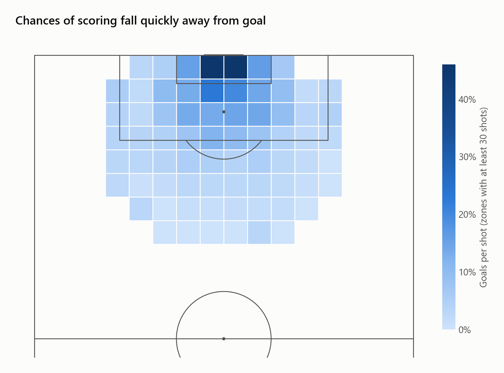
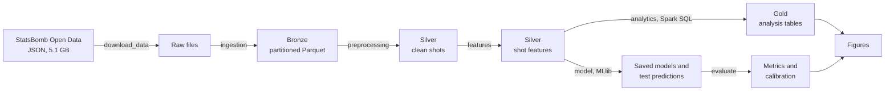
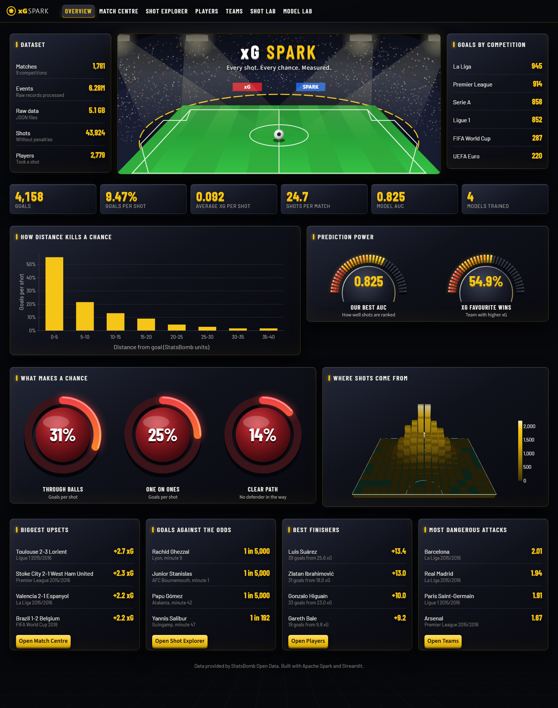

# xG-Spark: Expected Goals with Apache Spark

An end-to-end PySpark pipeline that turns 6.3 million football events into an **Expected Goals (xG)** model: the probability that a shot becomes a goal. It covers ingestion, cleaning, feature engineering, Spark SQL analytics, MLlib modelling, evaluation and visualization.

On 364 matches held out from training, the models reach an **AUC of 0.82–0.83**, close to StatsBomb's professional xG (0.832).



The full write-up is in [the project report](reports/REPORT.md).

## Results

Scores on 8,807 unseen shots. Lower log loss and Brier score are better.

| Model | AUC | Log loss | Brier | Mean xG (actual rate 0.0953) |
|---|---|---|---|---|
| Baseline (always the goal rate) | 0.5000 | 0.3146 | 0.0862 | 0.0945 |
| Logistic Regression | 0.8217 | 0.2451 | 0.0695 | 0.0965 |
| Logistic Regression (class-weighted) | 0.8221 | 0.5270 | 0.1727 | 0.3869 |
| Random Forest | 0.8159 | 0.2498 | 0.0707 | 0.0958 |
| Gradient-Boosted Trees | 0.8253 | 0.2455 | 0.0694 | 0.0976 |
| StatsBomb xG (benchmark) | 0.8324 | 0.2411 | 0.0685 | 0.0929 |

Class weights barely change how shots are ranked, but they inflate the probabilities about fourfold. An xG value has to be a real probability, so the unweighted models are the right choice here.

## Architecture



## Interactive dashboard

A 3D football analytics app built with Streamlit, with seven pages along the top. The stadium reacts to the mouse, cards tilt, pitches can be rotated, and shots stand as glowing columns.

- **Overview:** headline numbers, biggest upsets and the least likely goals.
- **Match Centre:** the xG race, shot map and win probability for any of the 1,781 matches.
- **Shot Explorer:** filter every shot by competition, team, player, body part, assist and phase of play.
- **Players:** scouting profiles, head-to-head comparisons and a leaderboard.
- **Teams:** real league tables against expected points, plus form and shot maps.
- **Shot Lab:** click anywhere on the pitch, get a live prediction from the trained model, and watch the shot fly in 3D.
- **Model Lab:** ROC curves, calibration and feature importance.



The app reads small exported files in `dashboard/datasets`, so it runs without Spark or the 5 GB dataset:

```bash
streamlit run dashboard/app.py
```

## Data

[StatsBomb Open Data](https://github.com/statsbomb/open-data), used under its open-data terms. The project uses men's football only: the 2015/16 seasons of the Premier League, La Liga, Serie A, Ligue 1 and part of the Bundesliga, plus the 2018 and 2022 World Cups and Euro 2020 and 2024.

| Item | Count |
|---|---|
| Matches | 1,781 |
| Events | 6,279,749 |
| Non-penalty shots | 43,924 |
| Goals from those shots | 4,158 (9.47%) |

## Project structure

```
src/
  config.py          paths, Spark settings and pitch geometry
  spark_session.py   builds the local Spark session
  download_data.py   Phase 1: parallel download of the open data
  ingestion.py       Phase 2: JSON to partitioned Parquet (bronze)
  preprocessing.py   Phase 3: clean, flat shots table (silver)
  features.py        Phase 4: geometry, defensive pressure and assist features
  analytics.py       Phase 5: Spark SQL gold tables
  model.py           Phase 6: MLlib pipelines and cross-validation
  evaluate.py        Phase 7: test-set metrics and calibration
  visualize.py       Phase 8: report figures
  export_dashboard.py Phase 10: prepares the dashboard's data
dashboard/           the Streamlit app and its exported data
notebooks/           the whole pipeline with its outputs
reports/             report, metrics, figures and screenshots
scripts/             environment check
```

`data/` and `models/` are created by the pipeline and are not stored in Git.

## Run it

You need Python 3.11, JDK 17 and, on Windows, `winutils.exe` and `hadoop.dll` for Hadoop 3.3.6. Set `JAVA_HOME` and `HADOOP_HOME` in `src/config.py` to match your machine.

```bash
python -m venv .venv
.venv\Scripts\activate
pip install -r requirements.txt
python scripts/check_setup.py
```

Then run each phase from the project root, in this order. The download is about 5 GB, and training takes about 9 minutes on 12 CPU cores.

```bash
python -m src.download_data
python -m src.ingestion
python -m src.preprocessing
python -m src.features
python -m src.analytics
python -m src.model
python -m src.evaluate
python -m src.visualize
python -m src.export_dashboard
```

## Limitations

- Results come from one held-out split, so small gaps between models may not be meaningful.
- The Spark job runs in local mode on one machine. The same code would run on a cluster, but that hasn't been tested.
- Bayer Leverkusen is the only Bundesliga team with a full season in the open data.

## Acknowledgement

Data provided by [StatsBomb](https://statsbomb.com/).
